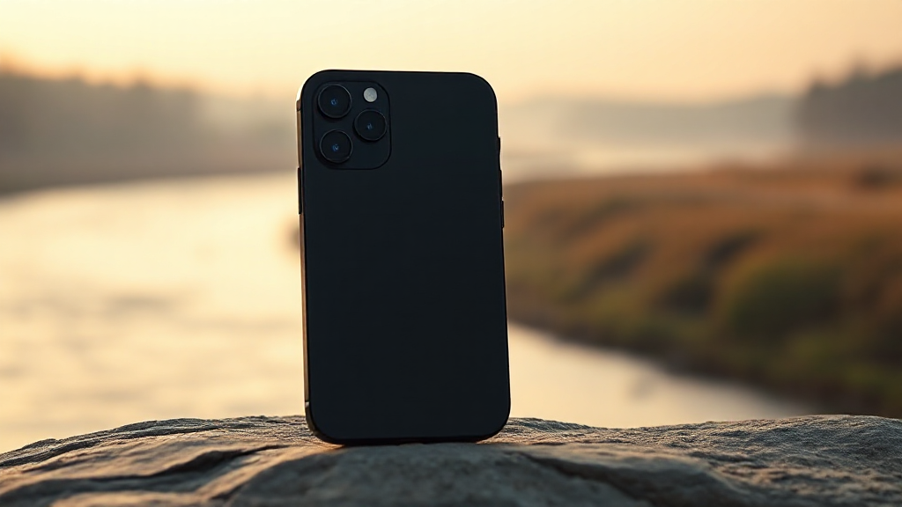

# 🦋 ButterFly — Banner Art Director

**The AI art director that asks before it draws.**

Most image tools take a prompt and hand you a pretty picture. ButterFly interviews you like a real art director — eight adaptive questions about framing, setting, audience, mood and offer — then writes the ad copy, renders the banner on your own machine, critiques its own work, and exports a layered Photoshop file.

No cloud. No API keys. No per-image cost. Nothing leaves your laptop.



*Real output. Brief: "fall boot sale for a rugged outdoor brand", rendered locally in 90 seconds.*

---

## How it works

1. **Interview** — a vision LLM (Qwen2.5-VL-7B) asks tailored creative and marketing questions one at a time, reacting to each answer rather than reading from a script. It recommends a pick on every question.
2. **Image** — your answers are synthesised into a full art-direction prompt and rendered on-device with FLUX.1-schnell. Upload a product photo and it's cut out with rembg and composited into the generated scene, so your *actual* product appears.
3. **Text** — the headline, kicker, CTA, brand and contact are overlaid as crisp HTML/CSS, never drawn by the image model, and auto-placed per image.
4. **Critique** — the vision model scores each banner on focal clarity, copy space, colour harmony, product prominence and polish, writes a verdict, and proposes fixes you can tick and regenerate from.
5. **Edit** — drag, retype, resize and recolour any text element directly on the banner.
6. **Export** — download a PNG with the text composited in, or a layered `.psd` (background, detected objects, product, one layer per text block).

## Why it's different

**It proves its own value.** While you answer question one, the system quietly renders your raw brief exactly as typed. At the end it shows both images side by side — same seed, same size, only the prompt differs. You see precisely what the interview bought you.

**The text stays editable.** Every other tool bakes mangled text into pixels. Here the copy is a real layer in the browser and a real layer in the PSD.

**It runs on your laptop.** Relevant for anyone who can't send unreleased product imagery to someone else's GPU.

## Requirements

- **Apple Silicon Mac**, **16 GB RAM minimum** — this is tight; FLUX peaks around 14 GB
- **~17 GB free disk** for models and the Python environment
- **Python 3.12** and **Node 18+** (the setup below installs both locally if you don't have them)

## Setup

### 1. Backend

Uses [`uv`](https://docs.astral.sh/uv/) to manage Python. Install it if you don't have it:

```bash
curl -LsSf https://astral.sh/uv/install.sh | sh
```

Create the environment and install dependencies:

```bash
cd backend && uv venv --python 3.12 ../.venv && uv pip install --python ../.venv/bin/python -r requirements.txt
```

### 2. Frontend

Needs Node 18+. If `node` is missing, grab the official build (no admin required):

```bash
mkdir -p "$HOME/.local/node" && curl -sL https://nodejs.org/dist/v22.11.0/node-v22.11.0-darwin-arm64.tar.xz | tar -xJ -C "$HOME/.local/node" --strip-components=1 && export PATH="$HOME/.local/node/bin:$PATH"
```

Build the UI to static files, which the backend then serves at zero extra memory cost:

```bash
cd frontend && npm install && npm run build
```

### 3. Run

```bash
cd backend && ../.venv/bin/python -m uvicorn main:app --host 127.0.0.1 --port 8000
```

Open **http://127.0.0.1:8000**. Models download automatically on first use.

## What to expect

Measured on an **Apple M5, 16 GB, ~140 Mbps connection**:

| Step | Time | Notes |
|---|---|---|
| Python dependencies | ~4 min | ~90 packages, 1.6 GB on disk |
| Frontend build | ~30 s | 784 KB of static output |
| Model download | **8 min 45 s** | one time only, ~15 GB |
| First interview question | ~23 s | includes loading the vision model cold |
| **Full render — 2 banners + critique** | **~90 s** | model swap, FLUX ×2, art-director review |

Models downloaded on first run:

| Model | Size | Role |
|---|---|---|
| `mflux-community/flux-1-schnell-mflux-q4` | 8.95 GB | image generation |
| `mlx-community/Qwen2.5-VL-7B-Instruct-4bit` | 5.27 GB | interview, copy, critique |
| rembg (`bria-rmbg`) | 992 MB | product cutout |
| FastSAM-s | 23 MB | segmentation for PSD layers |

## The 16 GB problem

FLUX and Qwen-VL cannot both be resident in 16 GB — FLUX alone peaks around 14 GB. The two models are **swapped sequentially** by `backend/model_manager.py`, loaded and unloaded around each stage of the pipeline. The UI surfaces that swap as a named step rather than hiding it, so the pause reads as a stage rather than a hang.

Close memory-hungry apps before your first render.

## Development

Rebuilding for every CSS tweak is slow. Run two terminals instead:

```bash
cd backend && ../.venv/bin/python -m uvicorn main:app --host 127.0.0.1 --port 8000
```

```bash
cd frontend && npm run dev
```

Work at **http://localhost:3000** — `lib/api.js` detects port 3000 and calls the backend on :8000 automatically, so you get hot reload against live models. Run `npm run build` once when you're done so :8000 serves the latest.

## Project layout

```
backend/
  main.py            FastAPI app + endpoints (interview, generate, export, upload)
  model_manager.py   sequential FLUX <-> VLM swap manager (the 16 GB constraint)
  flux_runner.py     FLUX.1-schnell image generation (mflux)
  vlm_runner.py      Qwen2.5-VL interview / copy / critique
  prompts.py         the "art director" brain (adaptive interview, synthesis, copy)
  composite.py       product cutout + scene compositing (rembg + PIL)
  segment.py         object segmentation for PSD layers (FastSAM)
  psd_export.py      layered .psd builder (pytoshop)
  fonts_ttf/         fonts used for rasterizing PSD text
frontend/
  app/page.jsx       the whole React app (brief, interview, results, editor)
  app/globals.css    the Daylight design system
  lib/api.js         API base resolution (dev :8000 vs same-origin build)
  public/fonts/      Anton + Archivo, the banner display faces
```

## Troubleshooting

**`address already in use` on port 8000** — a previous server is still running. Closing the terminal tab doesn't always kill it:

```bash
lsof -ti:8000 | xargs kill -9
```

**`node: command not found`** — Node is in `~/.local/node/bin`. Add it to your shell profile, or open a new terminal if you only just added it.

**UI changes not showing at :8000** — the backend serves a static build. Run `npm run build` in `frontend/`, then refresh.

**Render is extremely slow or the machine swaps** — something else is holding RAM. Quit it and retry; 16 GB leaves almost no headroom during the FLUX peak.

## Credits

Built as a hackathon project.

- **Ritesh Yadav** ([@ritesh040197](https://github.com/ritesh040197)) — backend, model pipeline
- **Mohammad Usman Nizam** ([@usmann56](https://github.com/usmann56)) — backend, model pipeline
- **Kamil Akhtar** ([@kamilakhtar015](https://github.com/kamilakhtar015)) — frontend and UI

Models: [FLUX.1-schnell](https://huggingface.co/black-forest-labs/FLUX.1-schnell) (Black Forest Labs), [Qwen2.5-VL](https://huggingface.co/Qwen/Qwen2.5-VL-7B-Instruct) (Alibaba), run through [MLX](https://github.com/ml-explore/mlx) and [mflux](https://github.com/filipstrand/mflux) on Apple Silicon.
